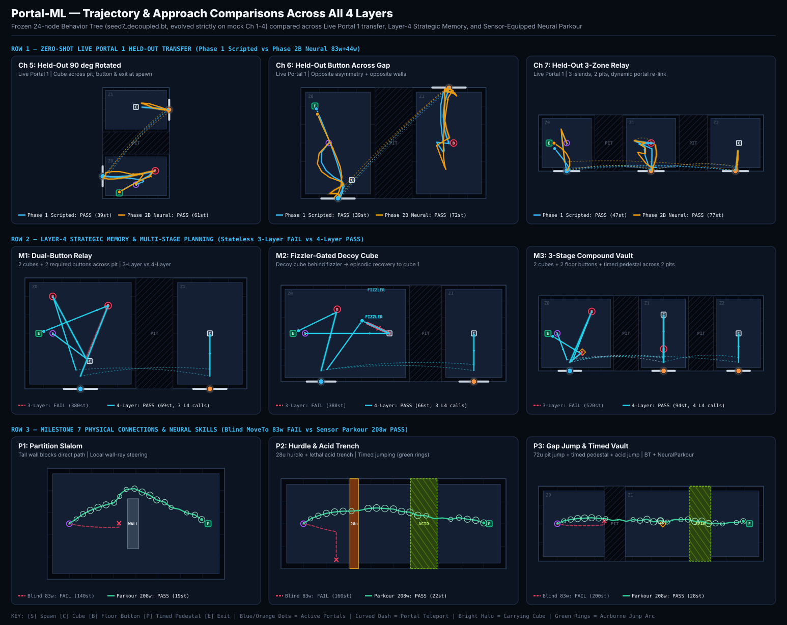
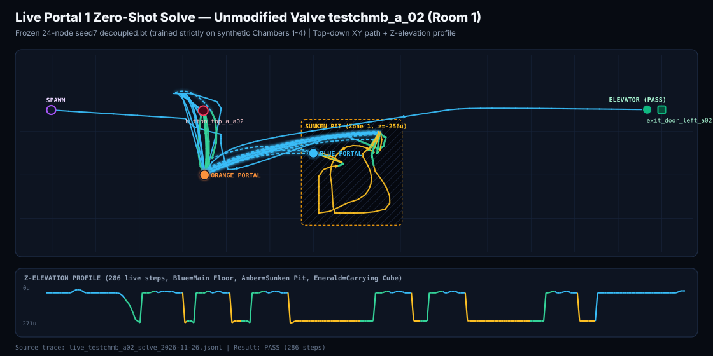

# Portal-ML

A hybrid neuroevolutionary reasoning agent for *Portal* (Source Engine) that decouples **causal reasoning** (evolved as a readable Behavior Tree DSL over a symbolic Blackboard) from **motor execution** (deterministic Phase-1 primitives now, swappable for neuroevolved neural networks in Phase 2).

The core claim is architectural: separating *what* subgoal entity to pursue from *how* to reach and interact with `target` lets an agent trained strictly on Chambers 1–4 generalize zero-shot to a held-out rotated puzzle (Chamber 5) that combines cubes, buttons, and portals for the first time.

## Trajectory & Approach Visualizations

Generated directly from recorded live Portal 1 and simulator traces via `python scripts/render_paths.py` (individual per-chamber SVGs in [`docs/images/chambers/`](docs/images/chambers/)):



**Unmodified Valve Campaign Chamber (`testchmb_a_02` Room 1 / Test Chamber 04) — Live Portal 1 Zero-Shot Solve:**



## Status (2026-11-27)

- **3-layer PoC and 5-chamber mock 3D simulator built and measured.** Pure Python 3.12 (zero external dependencies) runs at **1,978 episodes/sec** (**42,734 ticks/sec**) on one desktop core (`python scripts/benchmark_sim.py --episodes 5000`).
- **Decoupled vs unconstrained ablation measured (5 seeds, pop 120, max 120 gens, trained strictly on Chambers 1–4):**
  - `decoupled` (`SEQUENCE(goal_selector, execution)`): **4/5 seeds** solved all 4 training chambers; **2/5 seeds** passed held-out Chamber 5 zero-shot in **44–45 steps** (mean size 21.8 AST nodes).
  - `unconstrained` (flat single BT): **0/5 seeds** solved Chambers 1–4 (all stalled at 2/4); **0/5** passed Chamber 5.
- **Live Portal 1 (`appID=400`) map, C++ server plugin, and sim-to-Source transfer verified (Milestone 1, 2026-11-26).**
  - Single-map 5-chamber `.vmf` compiled cleanly through Portal 1 `vbsp`, `vvis`, and `vrad` with zero leaks (512 triangles, 5 airtight chambers separated by 2048u void gaps, flush 1u concrete portal panels, and `point_teleport` reset targets).
  - 32-bit x86 MSVC C++17 server plugin (`ISERVERPLUGINCALLBACKS003`, zero `tier0.lib`/`tier1.lib` link dependencies) compiled cleanly and verified live over `127.0.0.1:27500`.
  - **Mock-evolved champion (`champions/seed7_decoupled.bt`, 24 nodes, trained strictly on Chambers 1–4 in Python) transferred zero-shot to live Portal 1 and cleared 5/5 chambers** in ~11.0s total (`records/live_seed7_2026-11-26.jsonl`):
    - Chamber 1: PASS (11 steps, 1.16s, reset 104.5ms)
    - Chamber 2: PASS (27 steps, 2.84s, reset 96.5ms)
    - Chamber 3: PASS (20 steps, 2.10s, reset 105.3ms; cube dropped 7u from button center)
    - Chamber 4: PASS (11 steps, 1.08s, reset 103.5ms; live `prop_portal` traversal across pit)
    - Chamber 5 (held-out): **PASS zero-shot** (38 steps, 3.86s, reset 104.2ms; bidirectional portal crossing with cube, dropped 1.2u from button center)
- **Phase 2 neuroevolved neural motor primitives verified on mock AND live Portal 1 (Milestone 2, 2026-11-26).**
  - Evolved two small egocentric MLPs from random Gaussian weights (`python scripts/train_phase2_motor.py --seed 7`): `champions/moveto_mlp.json` (`6->8->3`, **83 weights**, 100% validation in 25.9s) and `champions/aim_mlp.json` (`4->6->2`, **44 weights**, 100% validation in 7.7s).
  - Plugged underneath the **frozen** `champions/seed7_decoupled.bt` (zero retraining of Layer 2):
    - **Phase 2A (neural `MoveTo`, 83w):** **5/5 mock** (16/18/27/10/47 steps) and **5/5 live Portal 1** (11/12/23/10/51 steps; `records/live_phase2a_2026-11-26.jsonl`).
    - **Phase 2B (neural `MoveTo` + neural `ShootPortal Aim`, 127w total):** **5/5 mock** (16/18/27/20/67 steps) and **5/5 live Portal 1** (12/12/24/24/85 steps; `records/live_phase2b_2026-11-26.jsonl`).

- **Generalization hardening, expanded 3-chamber held-out suite, and 7/7 live Portal 1 verification (Milestone 3, 2026-11-26).**
  - Expanded the held-out suite to three unseen chambers (`HELD_OUT_CHAMBERS = (5, 6, 7)`): Chamber 5 (90° rotated cube across gap), Chamber 6 (cube at spawn, floor button across gap with opposite-facing walls), and Chamber 7 (3-zone, 2-pit portal relay requiring two mid-episode portal re-links).
  - Diagnosed zero-shot failures to two root causes: an asymmetric unguarded `Drop()` primitive in `BehaviorTreeEvaluator` and two training-set spurious correlations (`wall_exists <=> target_unreachable` in Chamber 3; `portals_active <=> portals_bridge(target)` in Chamber 4).
  - Fixed `Drop()` target-locality symmetry + added two training-only causal invariance augmentations strictly on Training Chambers 3 & 4 (zero held-out leakage). Across 10 seeds (`[1, 2, 3, 5, 7, 11, 13, 17, 21, 42]`, pop 120, gens 120):
    - Baseline decoupled: `train_4/4 = 8/10`, `Ch5 = 3/10`, `Ch6 = 3/10`, `Ch7 = 3/10`, `all 3 held-out = 3/10`.
    - `+ Drop()` symmetry: `train_4/4 = 10/10`, `Ch5 = 6/10`, `Ch6 = 6/10`, `Ch7 = 5/10`, `all 3 = 5/10`.
    - `+ Causal invariance augmentation`: `train_4/4 = 9/10`, `Ch5 = 7/10`, `Ch6 = 8/10`, `Ch7 = 7/10`, **`all 3 held-out = 7/10` (2.33x baseline)**.
  - Canonical 5-seed ablation (`[1, 7, 13, 21, 42]`): `decoupled` solved **5/5 train** and **4/5 (80%) across all three held-out chambers (5, 6, 7)** vs `unconstrained` **1/5 (20%)**.
  - Synced Chambers 6 & 7 into `portal_ml_5chambers.bsp` (956 triangles, zero leaks) and `blackboard_extractor.cpp`, and verified **7/7 chambers PASS live in Portal 1** for BOTH Phase 1 scripted (`11/27/19/11/39/39/47` steps, 1.50s total; `records/live_7ch_phase1_2026-11-26.jsonl`) and Phase 2B neural `MoveTo(83w) + Aim(44w)` (`11/10/20/22/61/72/77` steps, 2.23s total, ~7.2ms resets; `records/live_7ch_phase2b_2026-11-26.jsonl`).
- **Real Portal 1 campaign feasibility audited (`docs/REAL_GAME_ANALYSIS.md`, 2026-11-26).** Audited all 24 real Valve `.bsp` maps directly from `portal_pak_dir.vpk` via `scripts/audit_campaign_maps.py`, identifying Tier-1 real campaign targets (`testchmb_a_00`, `a_01`, `a_02`, `a_05`, `a_06`) and the four upgrades required to scale toward full-game completion.
- **Native SendProp physics, live C++ milestones, and generic live-BSP discovery verified on unmodified `testchmb_a_02` (Milestone 4, 2026-11-26).**
  - Replaced per-tick `ent_fire !player AddOutput basevelocity` console strings with direct SendProp `m_vecBaseVelocity` + Portal 1 `FL_BASEVELOCITY` (`1<<23` under `-DPORTAL=1`) actuation and live C++ milestone reward reporting (`cube_grabbed`, `button_pressed`, `portal_*`, `portal_traversed`, `exit_reached`).
  - Verified **7/7 live Portal 1 PASS** for BOTH Phase 1 scripted (`13/35/22/11/51/40/43` steps, 2.66s total; `records/live_m4_native_phase1_2026-11-26.jsonl`) and Phase 2B neural `MoveTo(83w) + Aim(44w)` (`12/58/21/21/69/62/98` steps, 2.79s total, ~122 steps/sec, ~8.1ms resets; `records/live_m4_native_phase2b_2026-11-26.jsonl`).
  - Built C++ `BspScanner` (`source_plugin/src/bsp_scanner.cpp`) + Python mirror (`portal_ml/vmf/bsp_reader.py`) triggered automatically on `LevelInit` for arbitrary maps. Tested live on Valve's unmodified campaign map **`testchmb_a_02`** (`records/live_testchmb_a02_2026-11-26.json`): auto-discovered **9 gameplay entities** (cubes, composite `button_top_reference` floor buttons, exit doors) and **293 portalable concrete surfaces** (walls, floors, ceilings), streaming live `BlackboardSnapshot`s and native `MoveVector` motion over TCP IPC.
  - Documented the proposed **4th-layer small-LLM strategic memory & subgoal planner** in [docs/FOUR_LAYER_ARCHITECTURE.md](docs/FOUR_LAYER_ARCHITECTURE.md).
- **First real unmodified Valve campaign chamber solved zero-shot (`testchmb_a_02` Room 1 / Test Chamber 04, Milestone 5, 2026-11-26).**
  - Extended generic `BspScanner` + `ExtractGeneric` with vertical elevation zone clustering (`zone 0` main floor vs `zone 1` sunken pit), single-portal-gun detection (`weapon_portalgun` `CanFirePortal1`/`CanFirePortal2`), elevator/fizzler parsing, live `prop_portal` outward normals, physical `func_door` displacement confirmation (`d > 52u` from closed doorway center), and real `weapon_portalgun` firing (`ent_fire weapon_portalgun FirePortal1`).
  - Added single-portal-gun remapping (`allow_orange_portal=False`) in `BehaviorTreeEvaluator` plus generic 2-stage obstacle wall-following and pit-edge avoidance in `MotorController`.
  - **The frozen 24-node `champions/seed7_decoupled.bt` (trained strictly on synthetic mock Chambers 1–4, zero retraining) solved Valve's unmodified `testchmb_a_02` Room 1 end-to-end live in Portal 1:** triggered Valve's box dropper, entered the sunken pit, grabbed Valve's `box`, fired the real `weapon_portalgun` to open a Blue portal linked to Valve's fixed Orange portal, carried the cube through the portal, physically depressed `button_top_a_a02` to slide `exit_door_left_a02` / `exit_door_right_a02` open, walked past the fizzler, and entered the middle elevator (`a02-middle_elevator_body`).
  - Measured live results: fastest verified solve **106 steps (11.87s, reward 174.70)**; saved verified pass trace (`records/live_testchmb_a02_solve_2026-11-26.jsonl`, **286 steps, 33.68s, reward 165.70**, all 7 milestones). Honest limitation: drop repeatability on `testchmb_a_02` within 350 steps is ~1/3–2/3 across launches because Valve's ceiling dropper spawns a spare `box` sharing `targetname="box"` and `point_teleport` VPhysics settling can roll off the circular button rim (replacing `point_teleport` with native `+use` / `CPlayerPickupController` carry-and-drop is queued for future motor hardening).
  - Verified **zero regression** on the 7-chamber custom suite (`portal_ml_5chambers`, `-textmode`): **7/7 PASS** Phase 1 scripted (`13/35/22/11/49/39/45` steps) and **7/7 PASS** Phase 2B neural `MoveTo(83w) + Aim(44w)` (`13/59/21/20/72/61/86` steps).
- **Layer-4 event-driven strategic memory & subgoal planner built and benchmarked live with local small LLMs (Milestone 6, 2026-11-27).**
  - Implemented `portal_ml/planner/` (zero external dependencies): rolling deduplicated `EpisodicMemory(max_entries=8)`, affordance-gated dynamic `json_schema` semantic subgoals (`place_cube_on_button`, `press_pedestal`, `go_to_exit`), `StrategicDirective` snapshot validation, `RuleBasedStrategicPlanner`, and `OpenAICompatibleLLMPlanner` (LM Studio / Ollama / `llama-server` client with `<think>...</think>` stripping and graceful fallback).
  - Controlled 3-layer vs 4-layer ablation (`scripts/ablate_layer4.py`) underneath the **frozen** 24-node `champions/seed7_decoupled.bt` (zero retraining) across standard Chambers 1–7 and three multi-stage chambers (`M1: Dual-Button Relay`, `M2: Fizzler-Gated Decoy Cube`, `M3: Three-Stage Compound Vault`):
    - **3-layer (`none`):** `7/7` standard + **`0/3` multi-stage** (both scripted and Phase 2B neural).
    - **4-layer (`rule`, `records/ablation_layer4_2026-11-27.json`):** `7/7` standard + **`3/3` multi-stage** on both scripted (`69/66/94` steps) and Phase 2B neural (`87/82/149` steps; `3/3/4` calls).
    - **4-layer live `phi-4-mini-instruct` (3.8B, 2.49 GB via LM Studio, `records/ablation_layer4_phi4mini_2026-11-27.json`):** **`7/7` standard + `3/3` multi-stage on BOTH scripted (`116/66/91` steps, 23 calls, avg 470 ms/call) and Phase 2B neural (`81/82/152` steps, 22 calls, avg 461 ms/call)** — **20/20 zero-shot PASS**, `0` fallbacks, `0` warnings.
    - **4-layer live `liquid/lfm2.5-1.2b` (1.2B, 1.25 GB via LM Studio, `records/ablation_layer4_lfm25_2026-11-27.json`):** **`7/7` standard + `1/3` multi-stage** on both scripted (`M2` PASS 42 steps; avg 368 ms/call) and Phase 2B neural (`M2` PASS 65 steps; avg 332 ms/call, ~28% faster at half the VRAM), `0` fallbacks/warnings — exposing a clean Stage-2 switching target for Milestone 7 LoRA distillation.
  - Wired `--planner {none,rule,llm}` into `scripts/replay_live.py` and documented full comparison & setup in [docs/FOUR_LAYER_ARCHITECTURE.md](docs/FOUR_LAYER_ARCHITECTURE.md).
- **Human-equivalent physical connections (Python + C++ Source Engine) & neuroevolved `NeuralParkourPolicy` (Milestone 7, 2026-11-27).**
  - Upgraded Layer 1 (`PlayerState` + `LocalSensors` + `HazardVolume`) with live proprioception (`health`, `on_ground`, `ducking`, `water_level`), 13-channel egocentric non-visual LiDAR (`8` wall rays, `3` floor-drop probes, `step_clearance`, `hazard_ahead`) via native Source **`IEngineTrace` (`EngineTraceServer003`)**, and BSP `trigger_hurt` AABB discovery.
  - Upgraded Layer 3 (`MoveVector`) to full 6-DOF human body + interaction actuation (`forward`, `strafe`, `yaw_delta`, `pitch_delta`, `jump`, `crouch`, `use`, `fire_blue`, `fire_orange`) across `MockPortalEnv` and the 32-bit C++ plugin.
  - Verified live inside Portal 1 (`portal_ml_5chambers`, `records/live_physical_connections_2026-11-27.json` & unmodified Valve **`testchmb_a_08`**, `records/live_testchmb_a08_physical_2026-11-27.json`): live `IEngineTrace` wall/elevator/floor raycasts, real physical jump arc (**`delta_z = +60.48u`**, `saw_airborne = True`, `pitch = -6.0°`), and **7/7 PASS** live Phase-2B regression.
  - Evolved sensor-equipped **`champions/parkour_mlp.json`** (`12->12->4`, **208 weights**, 100.0% synthetic validation across 6 randomized 3D physics families). Controlled 13-chamber ablation (`scripts/ablate_parkour.py`, `records/ablation_parkour_2026-11-27.json`) underneath frozen `seed7_decoupled.bt`:
    - Scripted `MoveTo` & blind `NeuralMoveTo (83w+44w)`: `7/7` standard, `3/3` multi-stage, **`0/3` parkour (`P1–P3`)**.
    - Sensor `NeuralParkour (208w+44w)`: **`7/7` standard, `3/3` multi-stage, `3/3` parkour** (`P1` Partition Slalom 19 steps, `P2` Hurdle & Acid Trench 22 steps, `P3` Gap Jump & Timed Vault 28 steps) — **13/13 PASS**.
- **Multi-skill neural routing, first full 4-layer live Portal 1 sweep, and `LFM2.5-1.2B` distillation corpus (Milestone 8, 2026-11-27).**
  - Upgraded C++ `step_clearance` to ignore movable `prop_physics` cubes and upgraded `HybridMotorController` with automatic sensor-driven `skill_mode` routing (`precision 83w` <-> `parkour 208w` + `aim 44w`): **13/13 mock sweep** (`7/7` standard + `3/3` multi-stage L4 + `3/3` parkour P1–P3).
  - **First-ever full 4-layer live Portal 1 sweep (`records/live_7ch_4layer_phi4mini_2026-11-27.jsonl`):** running live C++ `IEngineTrace` Blackboard + live **`phi-4-mini-instruct @ 4k`** (LM Studio) + frozen 24-node `seed7_decoupled.bt` + Multi-Skill Auto neural MLPs (`83w+208w+44w`) cleared **7/7 chambers live in Portal 1** (`13/59/21/21/70/60/87` steps; **13 total LLM calls**, 6.43s total LLM time, `0` fallbacks, `0` warnings).
  - Built zero-dependency ChatML distillation corpus generator (`scripts/build_layer4_dataset.py` -> `records/layer4_distill_train.jsonl` 500 examples / `val.jsonl` 100 examples, strictly disjoint from all test chambers) + LoRA training script (`scripts/train_lfm25_lora.py`) for tuning `LiquidAI/LFM2.5-1.2B-Instruct`.

What comes next is tracked in [docs/ROADMAP.md](docs/ROADMAP.md), [docs/REAL_GAME_ANALYSIS.md](docs/REAL_GAME_ANALYSIS.md), and [docs/FOUR_LAYER_ARCHITECTURE.md](docs/FOUR_LAYER_ARCHITECTURE.md): executing `LFM2.5-1.2B` LoRA training, native `+use` cube carry/drop, and multi-room live campaign runs (Milestone 9).

## The front door

    python tools/check.py
    python tools/check.py --control

Runs every gate (personal-path guard, Python↔C++ chamber 1–7 coordinate parity, held-out Chambers 5–7 isolation, `.vmf` integrity, Phase-2 checkpoint schema validation, and the 40-test unit/integration suite) and ends with `VERDICT: PASS`. Use `--quick` to skip the full evolution test during fast edits.

## Architecture

1. **Layer 1 — Perception -> Symbolic Blackboard** (`portal_ml/schema/blackboard.py`): Ground-truth JSON snapshot every tick in Source Hammer units (player position/velocity/yaw/zone/held object, entities, door/button states, portalable surface normals, active portal transforms).
2. **Layer 2 — Evolved Reasoning Layer** (`portal_ml/bt/`, `portal_ml/evolution/`): Readable Behavior Tree DSL (`SELECTOR`, `SEQUENCE`, `CONDITION`, `ACTION`) evolved by structural & semantic AST mutations and subtree crossover.
3. **Layer 3 — Motor Execution Layer** (`portal_ml/motor/`): Deterministic Phase-1 primitives (`MoveTo`, `Grab`, `Drop`, `Press`, `ShootPortal`) plus neuroevolved Phase-2 MLPs (`MoveTo` 83w + `Aim` 44w).
4. **Layer 4 — Event-Driven Strategic Memory & Planner** (`portal_ml/planner/`): Low-frequency (`1–4` calls/chamber) strategic focus binding (`WorkingMemory.role_overrides`) + bounded `EpisodicMemory`, pluggable across deterministic rules or local OpenAI-compatible small LLMs (`Phi-4-mini`, `LFM2.5`).

## 7-Chamber Testbed (4 Training + 3 Held-Out)

All 7 chambers share one `.vmf` coordinate space separated by 2048-unit void gaps along Y:

| Chamber | Name | Role | Validated Capability |
|---|---|---|---|
| 1 | The Hallway | Training | Bridge, fixed-timestep stepping, navigation |
| 2 | The Pedestal | Training | 2-step causality (timed pedestal -> open exit) |
| 3 | Box on Button | Training | Object permanence & state binding (grab -> carry -> drop -> exit) |
| 4 | The Simple Gap | Training | Non-Euclidean portal placement & traversal |
| 5 | Held-Out Generalization Test | **Held-Out** | Rotated 90° combo (cube across pit, floor button & closed exit at spawn) |
| 6 | Held-Out: Button Across Gap | **Held-Out** | Opposite asymmetry (cube & exit at spawn, floor button across pit, opposite-facing walls) |
| 7 | Held-Out: Three-Zone Relay | **Held-Out** | 3 disconnected islands separated by 2 pits; requires two mid-episode portal re-links (`0->2->1->0`) |

## Running

```powershell
# Run evolution on the fast mock simulator and test Chamber 5 zero-shot
python scripts/train_mock.py --seed 7 --gens 80

# Reproduce the 5-seed decoupled vs unconstrained ablation
python scripts/ablation_study.py --seeds 1 7 13 21 42 --pop 120 --gens 120

# Benchmark mock simulator throughput
python scripts/benchmark_sim.py --episodes 5000

# Render combined 3x3 showcase, live testchmb_a_02 SVG, and individual chamber SVGs
python scripts/render_paths.py

# Render any custom live or mock JSONL trace
python scripts/render_paths.py --trace records/live_testchmb_a02_solve_2026-11-26.jsonl --out docs/images/live_testchmb_a02_solve.svg

# Regenerate the 5-chamber .vmf and compile scripts
python scripts/generate_vmf.py
maps\compile_map.bat
```

## Live Portal 1

See [source_plugin/README.md](source_plugin/README.md) for building `portal_ml_plugin.dll` (32-bit MSVC against Valve's `source-sdk-2013` public headers). Once installed into `<Portal>\portal\addons\`:

```powershell
.\scripts\launch_portal.ps1
python scripts/test_live_portal.py
python scripts/train_mock.py --backend source --host 127.0.0.1 --port 27500
```

## Layout

| Folder | Contents |
|---|---|
| `portal_ml/` | Python library: `schema/` (Blackboard & LocalSensors), `bt/` (DSL & evaluator), `motor/` (primitives, MLPs & parkour benchmarks), `planner/` (Layer-4 memory, schema & LLM client), `viz/` (zero-dependency SVG path visualizer), `sim/` (3D mock env & chamber specs), `evolution/` (GP & motor trainers), `bridge/` (TCP IPC client), `vmf/` (`.vmf`/`.bsp` tools) |
| `source_plugin/` | 32-bit C++17 Source Engine server plugin (`ISERVERPLUGINCALLBACKS003`) |
| `maps/` | Generated `portal_ml_5chambers.vmf` and `vbsp`/`vvis`/`vrad` compile scripts |
| `scripts/` | CLI entry points: training, ablation, benchmarking, VMF generation, Portal launcher, live smoke test |
| `tools/` | Front-door verification gate (`check.py`) |
| `tests/` | Unit and integration tests (including loopback TCP IPC bridge and evolution generalization) |
| `docs/` | Project roadmap ([docs/ROADMAP.md](docs/ROADMAP.md)) |

## Not affiliated with Valve

Portal-ML is an independent research project. It is not affiliated with, or endorsed by, Valve Corporation. *Portal* and *Source* are trademarks of Valve Corporation.

## Licence

MIT, [LICENSE](LICENSE).
